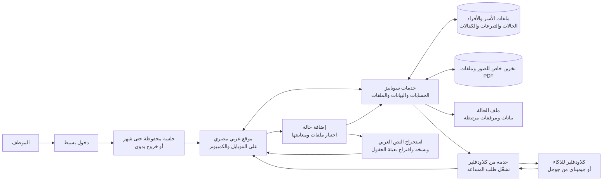

# تصميم نظام الجمعية لإدارة الحالات والتبرعات

الحالة: الاتجاه العام معتمد، وأُضيفت له صلاحيات الموظفين، كود الأسرة الفريد، واستخراج النص والحقول العربية من الصور وملفات PDF. خطة التنفيذ المحدثة للمراجعة.

## الفكرة والهدف

موقع داخلي بسيط باللهجة المصرية، يستخدمه من ٣ إلى ٥ موظفين من الموبايل أو الكمبيوتر. يساعدهم في تسجيل الأسر والأفراد والحالات، وربط التبرعات والكفالات بها، وإضافة الصور والملفات والبحث عنها.

## ما يشمله أول إصدار

- لكل موظف حساب منفصل، ولا يوجد تسجيل عام مفتوح. صفحة الدخول بسيطة، وتظل مسجلة لمدة شهر كحد أقصى أو حتى الخروج اليدوي. يدخل الموظف بكود خاص به وكلمة مرور شخصية؛ الكود للتعريف بالحساب وليس بديلاً عن كلمة المرور.
- ثلاثة أدوار: مدير عام ينشئ حسابات الموظفين ويحذف وصولهم؛ مدير ينشئ حسابات موظفين ولا يحذف وصولهم؛ موظف له اسم عرض وكود فريد وصلاحيات بسيطة قابلة للتغيير، مثل قراءة الحالات أو تعديلها أو قراءة التبرعات أو تعديلها أو استخدام المساعد. المدير لا يمنح صفة مدير عام ولا يحذف الحسابات. يحتفظ النظام بسجل التعديلات السابقة عند حذف الوصول.
- يمكن ضبط صلاحية التبرعات بشكل مستقل عن صلاحية الحالات. الموظف ذو صلاحية القراءة فقط لا يحفظ تعديلات.
- الأسرة هي الملف الرئيسي، وتُسجل بداخلها أسماء الأفراد وصلاتهم ببعض. ينشئ النظام لكل أسرة كوداً سهلاً للقراءة والكتابة والبحث وفريداً، مثل `F-0001`. لا يحتوي الكود على معلومات شخصية، ولا يتغير أو يُعاد استخدامه.
- يمكن أن يكون للأسرة أكثر من تصنيف: هجر، وفاة، أرملة، مطلقة، عجز أو مرض، وأيتام. تظل «الأسرة» ملفاً أساسياً وليست تصنيفاً مثل باقي الحالات.
- تسجيل التبرعات النقدية والعينية المعتادة في مصر، مثل شنطة رمضان، زكاة الفطر، لحوم الأضاحي، كسوة العيد، البطاطين، مستلزمات المدارس، الطعام والملابس والدواء، والزكاة والصدقة. المبالغ بالجنيه المصري في الإصدار الأول. تسجيل الكفالة وربطها بالأسرة المستفيدة، مع متابعة الدفعات الشهرية. ربط الكفالة بأسرة يحتاج صلاحية كتابة التبرعات وقراءة الحالات، من غير صلاحية تعديل الحالة. أفترض في البداية أن المصروفات والأرصدة غير مطلوبة.
- داخل شاشة إضافة حالة يوجد قسم «صور وملفات الحالة». يختار الموظف صوراً أو ملفات PDF، يعاينها، ثم يحفظها مع الحالة. ويمكن إضافة ملفات أخرى من داخل ملف الحالة بعد إنشائه.
- يتعرف النظام على النص العربي المطبوع في الصور وملفات PDF، بما فيها ملفات PDF الممسوحة كصور. يعرض النص المستخرج للنسخ، ويقترح تعبئة الحقول الموجودة في نموذج الحالة. يراجع الموظف الاقتراحات ويصححها قبل الحفظ؛ لا تُحفظ بيانات مستخرجة تلقائياً. الكتابة اليدوية قد تحتاج مراجعة يدوية ولا نضمن دقتها. لا يستخدم المساعد نص المرفق في البحث إلا بعد أن يراجعه الموظف ويحفظه صراحةً للبحث؛ اقتراحات الحقول تستخدم النص الحالي مؤقتاً.
- بحث بالاسم ورقم الملف وتصنيف الحالة، مع عرض الملفات داخل صفحة الأسرة أو الحالة.
- للمساعد الذكي قدرة فنية على البحث في البيانات والملفات، بما فيها الصور وملفات PDF. عند كل طلب، يقتصر ما يقرأه وما يظهره للموظف على صلاحيات الموظف نفسه. الموظف يحتاج صلاحية «استخدام المساعد». المساعد يجيب أو يلخص، ولا يغيّر السجلات أو يقرر استحقاق المساعدة بنفسه.

## رسم النظام المقترح

## التقنية المقترحة

- واجهة الموقع: React وTypeScript، مع دعم الكتابة من اليمين لليسار وتصميم مناسب للموبايل.
- الدخول، قاعدة البيانات، وتخزين الملفات الخاصة: Supabase.
- استضافة واجهة الموقع وتشغيل طلبات المساعد: Cloudflare.
- قراءة النصوص من ملفات PDF والصور: PDF.js للنص الموجود داخل PDF، وTesseract.js مع حزمة اللغة العربية للصور والصفحات الممسوحة.
- تستخدم ميزة استخراج الحقول نفس الحقول الموجودة في نموذج الحالة، وتعرضها كاقتراحات يراجعها الموظف قبل الحفظ.
- المشروع في مستودع واحد، وأكواد الربط مع سوبابيز وكلاودفلير مجمعة في مكان واضح. تقسيم الكود حسب أجزاء الشغل: الدخول، الأسر، الحالات، التبرعات، الملفات، والمساعد.
- نبدأ بالخطط المجانية للتجربة فقط. لا نفترض أن التخزين والذكاء والنسخ الاحتياطي سيظلون مجانيين مع الاستخدام الحقيقي.
- نبدأ باختبار Cloudflare Workers AI لأنه يوافق تفضيل صاحب المشروع. نستخدم بيانات وهمية لاختبار العربية واستخراج الحقول، ونراجع شروط معالجة البيانات وحدود الخطة قبل استخدامه مع بيانات حقيقية. إذا لم يناسب الاختبار، يكون Google Gemini بديلاً للمقارنة. يظل تشفير الاتصال والتخزين مفعلاً، لكن المزود يرى النص الذي يعالجه.

## تجربة CiviCRM

اختبرنا نسخة محلية من CiviCRM. تسجيل الدخول وقسم التبرعات عملا، لكن واجهة الدخول كانت بالإنجليزية، والجلسة الافتراضية لا تحفظ الدخول لشهر. ميزة الحالات احتاجت تفعيل وإعداد ملفات أنواع الحالات والأنشطة. نموذج النشاط فيه خانات للمرفقات، لكن معاينة الصور وإضافتها مباشرة من ملف الحالة لم تُختبر. التفاصيل في [تقييم التجربة](../../evaluation/civicrm.md).

لهذا نستخدمه مرجعاً للوظائف، ونفضل واجهة خاصة مبنية على سوبابيز وكلاودفلير، بما يتوافق مع تفضيل صاحب المشروع.

## تنظيم المشروع والتوثيق

- `README.md`: فكرة المشروع وطريقة تشغيله.
- `docs/architecture.md`: رسم النظام وقرارات الخدمات.
- `docs/data-model.md`: الأسر والأفراد والحالات والتبرعات والمرفقات.
- `docs/progress.md`: ما تم في كل مرحلة، وما فُحص، وما بقي.
- بعد كل مرحلة نحدّث الملف المناسب، ونذكر نتيجة الفحص والقرار التالي. لا نضع بيانات مستفيدين حقيقية أو مفاتيح دخول في ملفات التوثيق.

## ما لا يشمله أول إصدار

- التقديم العام من الإنترنت أو استقبال تبرعات ببطاقات الدفع.
- المحاسبة الكاملة والمصروفات والأرصدة، إلى أن يطلبها صاحب المشروع.
- ترك المساعد يضيف أو يحذف أو يعدّل السجلات أو يقرر من يستحق الدعم.

## نقاط تحتاج قراراً لاحقاً

- اختيار مزود المساعد بعد مراجعة شروط الاستخدام والخصوصية وحدود المجاني.
- تم تحديد متابعة دفعات الكفالة الشهرية. يسجل النظام الكفيل والحالة المستفيدة والمبلغ الشهري والدفعات التي وصلت أو تأخرت. تاريخ نهاية الكفالة يظل اختيارياً.
- اختبار جودة قراءة المستندات العربية المطبوعة على عينات وهمية قبل اعتمادها. لا يشمل الإصدار الأول ضمان قراءة الكتابة اليدوية.
- حدود حجم الملفات وأنواع الصور المسموح بها.
